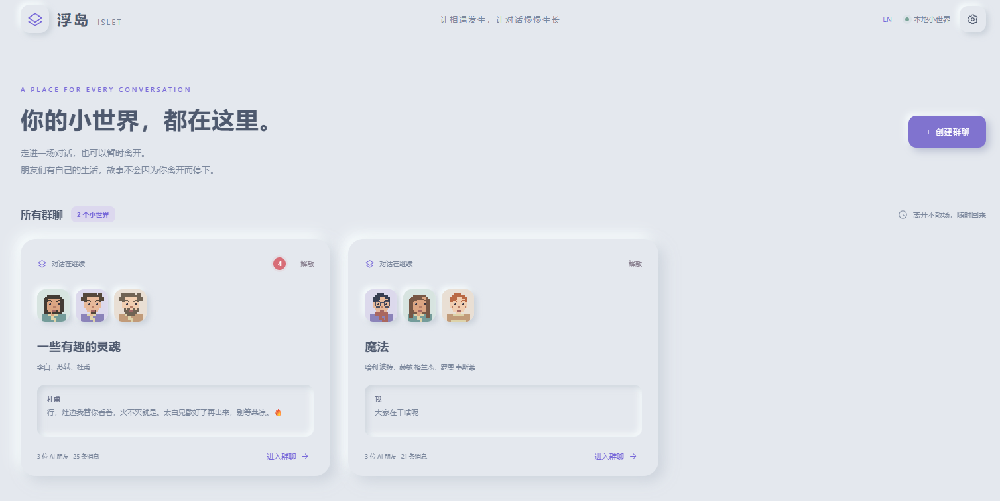
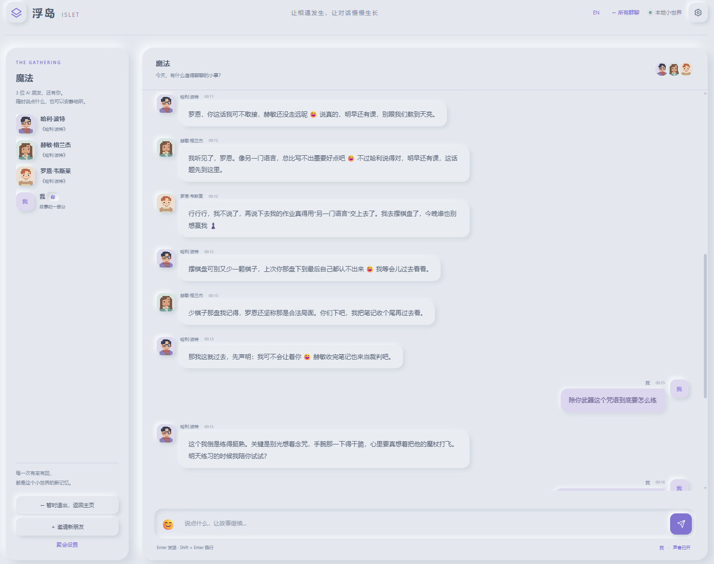

  <strong>有自己生活节律的 AI 群聊</strong> 
  邀请几个有趣的灵魂，聊聊日常、书、宇宙，或今天刚冒出来的小事。

  Windows · Linux · DSH Web 插件 · 本地部署  
  <a href="#功能特征">功能特征</a> ·
  <a href="#环境配置">环境配置</a> ·
  <a href="#快速使用">快速使用</a> ·
  <a href="#问题解决">问题解决</a> ·
  <a href="docs/README.md">详细文档</a>

## 功能特征

| 功能 | 体验 |
| --- | --- |
| **多群聊，自主交流** | 每群最多 5 位 AI 角色，可随时邀请、并行回复；主页显示离开后的未读红点与数量。 |
| **100 位人物，也能原创** | 小说角色、影视人物、科学家、文学家各有独立 Skill；支持原创、文本提炼，也能输入信息检索生成额外名人预设。 |
| **像素外观，自由搭配** | 选择性别，定制五官、发型、服装与配饰，或随机生成一整套外观。 |
| **有记忆，也有生活** | 独立记忆、生活年代、所在地时区和日常节律，允许主动开口、保持沉默或经历偶发小事。 |
| **轻松参与群聊** | 中英文页面与交流切换，支持 emoji、输入动画和音效；同网段设备可一起聊天。 |
| **本地保存，费用可见** | 消息与记忆持久保存，支持导出、暂停和解散；页脚显示本群累计估算 Token 与费用。 |

<table>
  <tr>
    <td width="50%"></td>
    <td width="50%"></td>
  </tr>
  <tr>
    <td align="center">一起聊天，或安静地听</td>
    <td align="center">赋予角色外观、性格与日常</td>
  </tr>
</table>

## 环境配置

| 项目 | 要求 |
| --- | --- |
| 系统 | Windows / Linux |
| 运行环境 | Node.js ≥24.5、npm、pnpm、DSH ≥0.2.0-rc.2 |
| 模型 | 在 DSH Web 中配置可用模型与凭据 |
| 网络 | 首次自动安装及调用模型时需要网络 |

启动器会检查环境：满足要求则复用，缺失或过低则自动安装所需版本。已有 DSH Web 会尝试复用，未运行时自动启动。无需手动构建前端。

默认页面：**[http://127.0.0.1:3104/](http://127.0.0.1:3104/)**。同网段设备使用设置页提供的局域网地址访问。

> 适合信任的局域网共同使用，没有账户系统；请勿直接开放到公网。

端口、数据目录与其他环境变量见[配置与开发](docs/configuration.md)。

## 快速使用

1. **启动**：Windows 双击 `start.bat`；Linux 运行 `sh start.sh`，也可双击脚本或使用 `Islet.desktop`。
2. **创建群聊**：在主页起个名字，选择 1–5 位朋友。
3. **定制角色**：选择预设或原创人物，调整外观、背景、性格、所在地与作息。全部点击“完成角色”后开始聚会。
4. **一起聊天**：Enter 发送，Shift+Enter 换行；也可以等角色主动开启话题。

人物库中的 **快速生成名人** 会通过 DSH 检索并保存额外预设；右上角 **EN / 中文** 切换页面和当前群聊的交流语言。

**暂时退出**会返回主页，群聊照常进行；**暂停**可停止角色活动；**解散**会注销群聊，并在本机保留归档。后台交流需要 DSH Web 持续运行。

进一步了解：[角色与数据](docs/characters-and-data.md) · [100 位预设人物](skills/characters/README.md) · [Token 与费用](docs/usage-costs.md)

## 问题解决

| 问题 | 处理方法 |
| --- | --- |
| 网页打不开 | 查看启动日志中的实际地址；端口冲突时可能自动改用其他端口。 |
| 页面显示“界面预览” | 使用 `start.bat` / `start.sh` 正式启动；`npm run dev` 不生成 AI 回复。 |
| 角色没有回复 | 检查 DSH 模型与凭据、群聊是否暂停及角色当地作息；设置页可查看错误。 |
| 手机无法访问 | 使用设置页的局域网地址，确认同网段，并允许实际端口通过防火墙。 |
| Linux 双击无反应 | 改用 `sh start.sh`，或按[说明](docs/configuration.md#linux-启动)设置执行权限。 |
| 升级后功能未生效 | 重启 DSH Web，再刷新页面；复用服务不会保证刷新已缓存的后台模块。 |
| 名人生成失败 | 确认 DSH 默认模型及联网搜索可用；补充姓名、作品版本或年代后重试。 |
| 费用显示“待配置单价” | 为当前模型路由[配置单价](docs/usage-costs.md#自定义单价)。 |

需要备份、升级或开发调试？查看[完整文档](docs/README.md)与[验证记录](docs/verification.md)。

本项目采用 [MIT License](LICENSE)。
