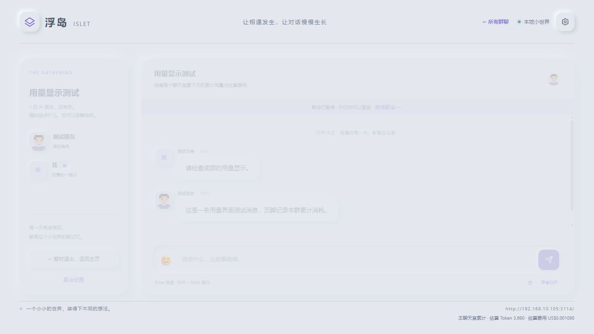

# Token 与费用

[返回项目首页](../README.md) · [全部文档](README.md)

每个聊天室最下方以小字显示本群累计的估算 Token 和费用，实时更新，退出再进入及服务重启后保留。鼠标悬停可查看输入、输出与估算说明。



## 统计范围

计入本群所有角色的主动发言、沉默判断、格式重试，以及已经产生用量的失败或取消请求。创建群聊前的文本角色提炼不归入任何聊天室；不同群聊相互独立。

优先使用 DSH 返回的输入、输出、缓存读取和缓存写入用量。推理 Token 已包含在输出中，不重复相加；缺少用量时按文本长度粗估。模型在对话 JSON 中自行声称的 usage 不用于计量。

旧群聊缺失的历史用量无法完整回溯，会注明“自更新后统计”。计量功能需要重启 DSH Web 加载 1.2.1 或后续版本后生效。

## 费用估算

默认包含 `deepseek-official` 的 Flash / V4 Pro 路由，按 [DeepSeek 官方公开高峰单价](https://api-docs.deepseek.com/quick_start/pricing/)保守估算，核对日期为 **2026-10-18**，单位为美元/百万 Token。

估算不模拟低峰折扣、优惠或账户账单。没有单价的路由显示“待配置单价”；部分请求无法计价时会注明。混用不同币种分别显示，不隐式换汇。

费用逐次累计保存。后续修改单价不会重新计算已经保存的费用。

## 自定义单价

在启动前设置 `CHATROOM_TOKEN_PRICES`，内容为 JSON 对象，键为精确的 `provider/model` 路由：

```json
{
  "my-provider/my-model": {
    "input": 1,
    "output": 2,
    "cacheRead": 0.1,
    "cacheWrite": 1,
    "currency": "USD"
  }
}
```

| 字段 | 含义 |
| --- | --- |
| `input` | 非缓存输入单价，必填 |
| `output` | 输出单价，必填 |
| `cacheRead` | 缓存读取单价，省略时使用输入单价 |
| `cacheWrite` | 缓存写入单价，省略时使用输入单价 |
| `currency` | `USD`、`CNY` 或 `EUR`，必填 |

所有单价均为**每百万 Token**的非负金额。配置后重启服务；自定义项可以覆盖同一路由的内置单价。

名人预设检索属于共享角色库的创建过程，不计入任一聊天室的累计用量；仍会使用 DSH 模型和联网服务，相关实际费用以宿主与提供商记录为准。
