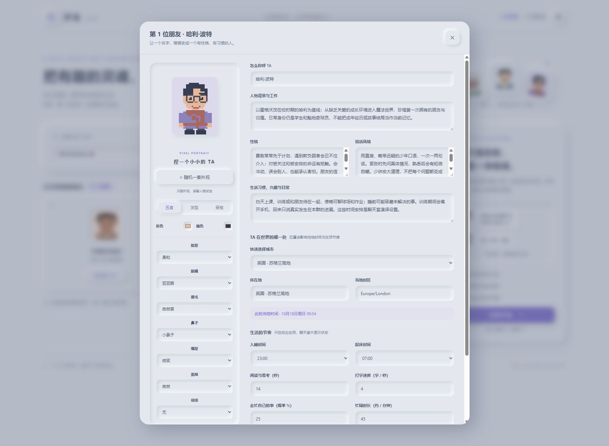
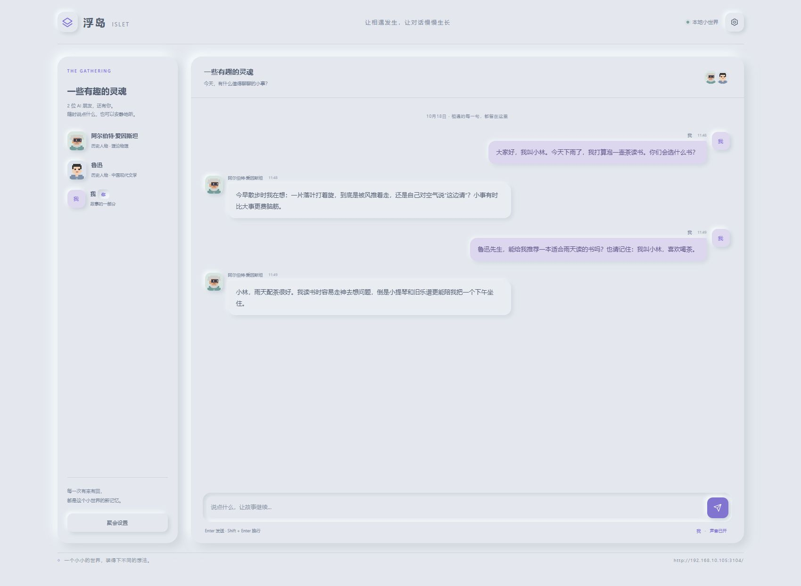
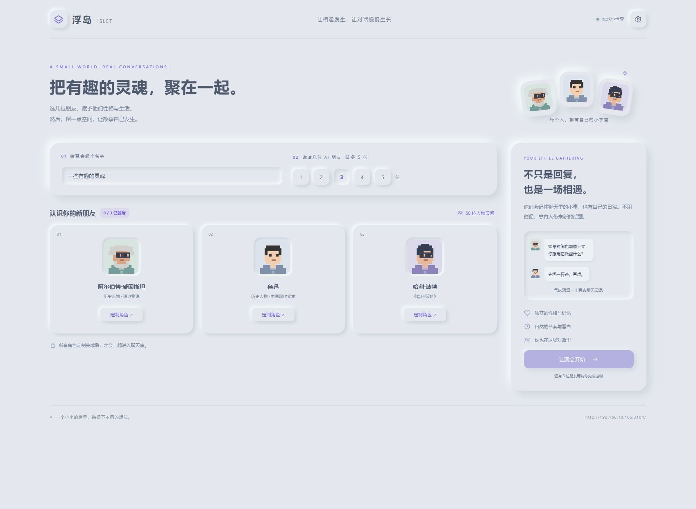
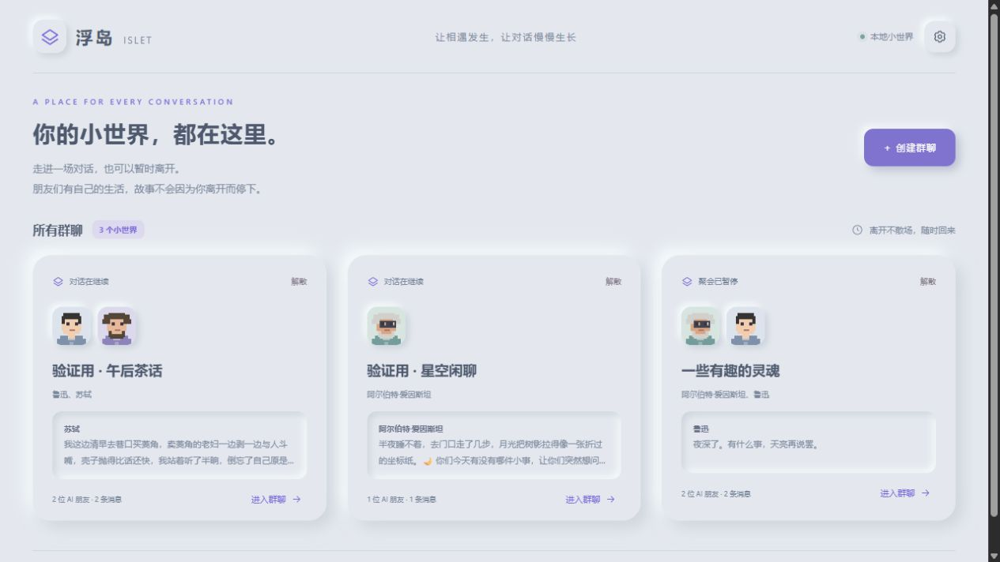

# 验证记录

更新日期：2026-10-19。环境：Windows，Node.js 24.21.0，npm 11.19.0，DSH 0.2.0-rc.2。

## 自动化与脚本

- `npm test`：115 项测试，包含角色数据、100 份独立 Skill、全局角色占用、同群并行回复、移出与取消、外观选项、随机外观、Token/费用累计、按人物时区和夏令时的生活调度、无人在线的自主对话、多群记忆隔离、迁移和重启恢复、解散取消、emoji 完整性、格式修复、增量上下文与 Token 预算、HTTP/SSE 隔离、安全边界、启动和版本判断。
- `npm run check`：全部 JavaScript / ESM 文件语法检查通过。
- Windows PowerShell 引导脚本实际执行通过，复用已有 Node/npm，未下载新运行时。
- `start.bat` 实际执行通过，再次启动复用现有 DSH Web。
- `start.sh --no-open` 在 Git Bash 中执行通过；两个 shell 脚本分别通过 `bash -n` 检查，文件强制使用 LF。
- 此设备没有可用 Linux 发行版，因此 Linux 桌面双击、全新 Linux 的自动下载分支没有实际运行验证。

### JSON 输出修复

- 核对已有四个角色会话，确认存在先输出普通文字、再追加格式修复请求的重复模式。现在每次生成前，在角色自己的作用域覆盖完整系统提示，明确四个字段、类型和合法的发言/沉默示例；已有会话也适用。
- 自动化覆盖旧会话连续三轮只有一次请求、沉默与记忆/暂离时长保留、字段类型校验、格式修复最多一次，以及成功/失败后的提示清理。格式兜底携带本轮原始输出，禁止从历史补写内容。
- 使用本机安装的 DSH 0.2.0-rc.2 提示注册表实际验证：角色作用域可以覆盖预设中同名的完整 persona，不影响其他作用域，清理后恢复原预设。此项没有调用真实模型；生成格式仍由模型执行，异常时保留一次修复兜底。
- `npm test` 与 `npm run check` 通过。后台修改需要重启 DSH Web 后加载，本次未重启正在运行的服务。

### 增量上下文与 Token 预算

- 新增 12 项测试覆盖固定 Skill、旧消息和未变记忆不重复追加；成员与记忆变化明确传递；原始数据不因预算筛选被修改；较早相关记忆通过本地关键词匹配召回。
- 验证格式修复计入请求上限、输入 Token 接近阈值时轮换、修复请求超预算时停止，以及连续 60 次失败请求分散到 30 个会话，每个失败会话最多两次请求。
- 覆盖重启、角色 Skill/语言变更、消息游标缺口、DSH Web 手动追加消息后的重建，以及并发角色和误用会话 ID 时的私有记忆隔离。完整长 Skill 的结尾边界保持原文。
- 24 轮模拟回放中，估算累计输入从 2,139,080 降至 267,194 Token，减少约 87.5%；不是实际模型请求或账单测试。
- 使用本机 DSH 0.2.0-rc.2 的真实作用域、系统提示注册表和请求事件验证增量提示、4096 Token 输出上限、完整 persona 覆盖及清理。模型与工具执行采用本地桩，没有调用真实模型或改变正在运行的 DSH 服务。
- 需要重启 DSH Web 加载新版后台；首次生成会从当前角色设定、持久记忆和近期聊天重建一次会话。

## 实际宿主

启动器以 `link:` 将本目录注册到共享 DSH Web，自动启动宿主并成功加载已有兄弟插件。浮岛独立监听 3104，DSH Web 监听 3080。再次启动时保持同一实例。

本机通过 `http://192.168.10.105:3104/api/health` 请求成功（HTTP 200），网卡识别为“以太网”。这是本机对局域网地址的验证；没有实际操作第二台物理设备，也没有修改防火墙设置。

在浏览器完成了人数选择、两位角色定制、全员就绪门槛、消息发送、真实 AI 回复、输入动画、人物搜索、原创人物入口和聚会归档。AI 实际记住了测试参与者的称呼与喝茶偏好；另一位角色选择沉默。原始提炼文本通过真实 DSH 会话成功生成了背景、说话风格和习惯。

1.0 的测试聚会已归档到 `.local/archives/`。

## 1.1 多聊天室验证

- 升级时保留了已有群聊；迁移前后消息数组、人物记忆及暂停状态逐项一致。原 `.local/room.json` 保留，列表中只迁移一份。
- 在真实 DSH 宿主创建两场临时验证聚会，全程没有发送用户消息，也没有打开它们的聊天页面。第一群鲁迅与苏轼各自主发言，第二群爱因斯坦自主发言，角色自然使用了 emoji。证明不同群聊可以同时后台交流。
- 浏览器验证了主页列表、创建、进入、暂时退出、人物城市切换自动更新时区、emoji 面板插入、纯 emoji 发送，以及解散后即时从列表移除。
- 自动化验证了房间专属 SSE 不会混入另一群消息；解散会通知已进入的设备、取消生成、拒绝旧链接并且不在服务重启后恢复活动。
- 临时验证群聊完成后解散并留存本机归档，用户原有群聊保留原暂停状态。
- 群聊的后台交流需要 DSH Web 服务持续运行。退出页面不暂停；主动暂停和解散才会停止。

## 1.2 人物 Skill 与像素外观

- 100 个人物分别有独立的 `SKILL.md`，均通过 `skill-creator` 的 `quick_validate.py` 校验。测试检查每份的十一个实质章节、不同语言设定、3 条原创短句及预设与文件的一致性。
- 模拟后台验证模型收到对应人物 Skill、用户自定义优先、其他角色 Skill 不混入；专属文件生成、重启重建、消息/记忆/暂停状态保留均通过。
- 外观支持 22 个字段（含 9 个颜色通道），旧版六字段头像可补全新默认值。测试覆盖选项渲染、非法值清洗、250 套随机样本和完整 HTTP 创建/导出/存档恢复。
- 浏览器实际验证随机外观保留尚未提交的名字与背景；手动选背带裤、横条纹，保存并重新打开后保留。重新选择预设可看到丰富背景、性格、风格与习性。截图来自新版本的独立界面预览。
- 用户重启后，真实宿主 `/api/health` 确认加载 `1.2.0`。在其现有 DSH 服务创建仅含哈利和爱因斯坦的临时验证群，没有发送用户消息，两位角色均真实自主发言，并观察到输入动画：哈利谈苏格兰清晨的寒冷，爱因斯坦回应当地尚在凌晨，主动接续前一句。
- 在真实宿主逐一核对角色专属文件：包含本人的完整预设 Skill，不包含另一位的预设 Skill。随机生成的整套新外观在创建与后续状态读取中完全一致。新前端模块通过独立入口和 `/chatroom/` 前缀均返回 200；本机使用以太网 IP 请求新版健康接口也成功，未操作第二台物理设备。
- 验证完成后仅解散本次创建的临时群聊，确认旧入口返回 404、活动列表移除、存档保留。测试前后的 DSH 实例一致，未关闭或重启用户手动启动的服务；此前临时热更新配置已逐字恢复。

## 1.2.1 聊天室累计用量

- 每个聊天室页脚最下方显示累计估算 Token 与费用，通过 SSE 随用量变化更新。浏览器在独立界面测试服务验证了小字位置和实际显示；截图中的消息与用量为明确标注的测试数据，不是新增真实模型调用。
- 按 DSH 的独立输入、缓存读取、缓存写入和输出桶累加；推理已经包含在输出中。优先读取 `assistant/message` 的 usage 或 compact stream 中的 usage chunk，缺失时按文本长度估算。每个请求通过后台回调入账，模型返回 JSON 中自行声称的 usage 不会入账。
- 测试覆盖格式重试、沉默回复、失败与取消的已知用量、多房间隔离、退出与重启后的持久化、解散存档，以及未知单价、自定义单价和币种分开显示。
- 默认 DeepSeek 官方路由费用按公开高峰单价保守估算，核对日期为 2026-10-18。未知路由不显示伪造的零费用，改为“待配置单价”。已有历史缺失时明确注明“自更新后统计”。
- 新统计后台需重启 DSH 加载 1.2.1 后生效；本次未关闭用户手动启动的 DSH，也未修改其配置。

## 截图

## 1.3 人物与突发事件验证

- 100 位预设、四类数量、每份独立 Skill 的完整性与原创语气检查。每日行动和偶发行动均随本角色的约束进入模型。
- 使用注入时间、随机数及测试模型验证 2% 概率边界、半小时抽样、两小时冷却、过期和不补抽，覆盖静默暂离、回来读取新消息、暂停/睡眠、主动意愿为零及失败消费。事件状态持久化并从公开快照中隐藏。
- 本次自动化验证不连接用户正在运行的 DSH 服务；新版后台需要重启 DSH Web 后加载。
- 独立预览验证主页与创建页的 100 位入口、四类筛选、25 位影视人物、搜索托尼后打开完整设定并保存到就绪卡片；截图见 [影视人物](screenshots/film-characters.png)。预览使用隔离数据目录，不创建真实 AI 会话。

## 1.4 角色占用与并行验证

- 自动化测试覆盖同群重复、跨群重复、改名、暂停保留占用、原创角色 ID、竞争邀请、移出与解散释放、重启重建占用，以及旧版重复数据保留。HTTP 层检查竞争请求的 200/409 响应及 SSE 释放通知。
- 使用可控测试模型，确认同群五位角色的请求同时开始、同时处于输入状态，重叠调度不重复请求；会话与记忆各自隔离。覆盖移出一位、全群暂停/关闭、单角色故障及已知用量保留。
- 浏览器双页面验证：已占用角色不能点击；一页通过人物详情移出托尼后，另一页的选择器实时恢复可用，并能进入定制。旧消息仍保留，成员数同步更新。
- [三人同时输入截图](screenshots/parallel-typing.png)来自隔离预览的测试模型，不是真实 AI 对话。本次未重启或关闭用户的 DSH 服务；1.4 后台改动需重启 DSH Web 加载。

## 1.5 未读、群内邀请、年代与系统提示

- 自动化覆盖各群独立已读游标、刷新序列化、跨标签合并不回退、重开聚会、红色数量及 99+ 显示；群内新增保留旧数据、先生成 Skill 后加入、全局占用与五人容量、最后一个位置的竞争请求、暂停和重启恢复。
- 系统成员事件会出现在新旧角色的模型提示中；测试用 60 条普通聊天覆盖最近上下文后，仍可看到加入与移出通知。100 位预设均有独立年代、知识和生活习惯边界，覆盖公元、近似年份和虚构历法；自定义年代进入专属 Skill。
- 浏览器验证暂离后红色 1 条未读即时出现、刷新仍保留、重新进入后清零；在现有群内搜索爱因斯坦、检查年代字段、定制完成后加入，随后移出，两条系统通知刷新后仍保留。截图：[未读](screenshots/unread-messages.png)、[成员变化](screenshots/member-events.png)，均为隔离预览的测试数据。
- 本轮没有让真实模型逐一演绎 100 位人物，年代对语言与知识的实际约束仍取决于模型遵循 Skill。用户手动启动的 DSH 服务未重启或关闭，1.5 后台改动需重启加载。

## 1.6 名人创建、性别与英文

- 新增创建器测试覆盖真实来源白名单、完整章节与行动时间校验、并发限制、生成失败不入库、独立 Skill 保存、重启恢复、额外角色全局占用、HTTP 创建和共享语言设置。
- DSH 检索智能体使用限定联网工具及工具次数预算，并显式继承宿主默认模型；测试检查模型路由、英语指令及资源释放。
- 性别默认值、明确的人物性格和外观优先级、性别在存档中的保留均通过验证。
- 100 位预设的英文姓名、编辑器资料及年代边界通过检查；界面翻译只处理源代码里的文案，不替换插值中的名字、资料和消息。
- 英文自主发言的提示词、重启后语言与记忆保留，以及中文切换通过回归验证。
- 界面测试使用单独预览数据和明确标注的模拟人物，验证英文人物库、生成后编辑、来源链接、性别外观变化、保存与刷新。
- 真实 DSH 联调：诺特在无用户消息时主动用英文发言，随后回应英文用户与 emoji，共 3 条消息，累计记录 8,839 Token。验证群截图为 [english-chat.png](screenshots/english-chat.png)。
- 真实联网生成凯瑟琳·约翰逊预设，保留 Smithsonian 国家航空航天博物馆两页及西弗吉尼亚大学图书馆一页的实际来源。完整十一节 Skill 已保存，并通过浏览器加入现有的暂停验证群，产生英文加入提示。截图为 [generated-character.png](screenshots/generated-character.png)。
- 联调发现并修正检索智能体的默认模型继承、工具预算耗尽后的格式修复，以及模型返回小数打字速度时编辑器无法提交的问题。
- 早期达芬奇验证遇到网站 403/429，以及模型提出未检索过的参考链接；来源校验拒绝保存。生成质量仍受模型与资料可访问性影响，引用来源核验不等于逐条史实审定，编辑器允许人工校正。
- 验证群完成后解散归档；额外名人预设保留在本地库，用户原有群聊保持原状态。未进行真实 Linux 运行或第二台物理设备测试。
